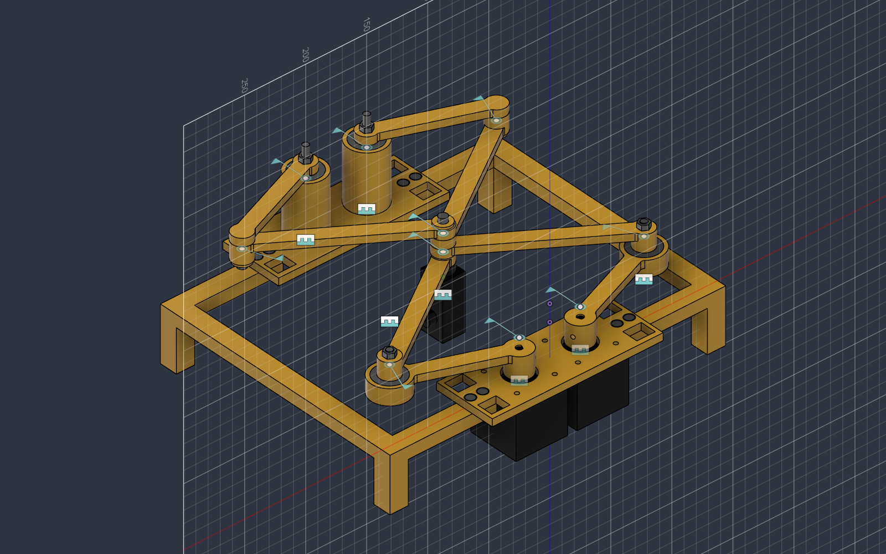
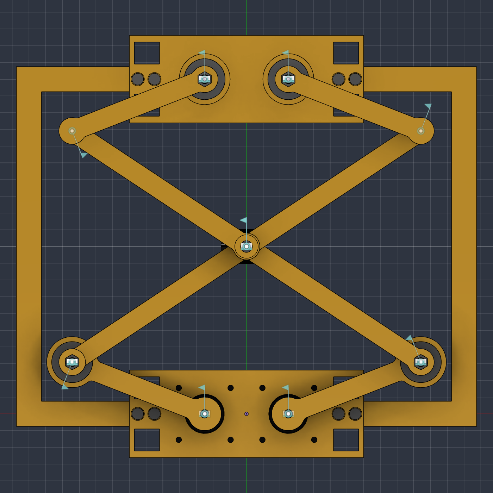
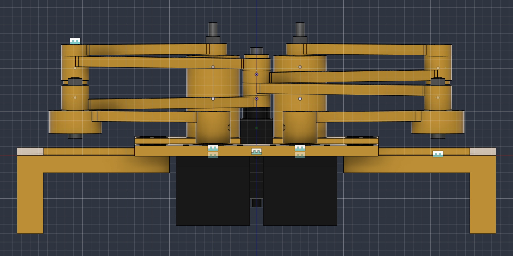

# 👆 tapbot

**A 3D-printed five-bar robot that taps a phone screen.**
Two NEMA 17 steppers, two TMC2209 drivers and a BeagleBone Black move a
tip anywhere over a 200 × 100 mm area, in straight lines, in millimetres.
A solenoid on the tip will do the tapping.



## 📑 Contents

- [Highlights](#highlights)
- [Overview](#overview)
- [Geometry](#geometry)
- [Bill of materials](#bill-of-materials)
- [Printed parts](#printed-parts)
- [Assembly](#assembly)
- [Parametric Fusion model](#parametric-fusion-model)
- [Wiring](#wiring)
- [Build the SD-card image](#build-the-sd-card-image)
- [Flash and boot](#flash-and-boot)
- [Homing without endstops](#homing-without-endstops)
- [Usage](#usage)
- [First test on the hardware](#first-test-on-the-hardware)
- [How the kinematics work](#how-the-kinematics-work)
- [Repository layout](#repository-layout)

<a id="highlights"></a>

## 🌟 Highlights

- 🖨️ **Mostly 3D printed**: 18 printed parts, all of them fit a Snapmaker A250 bed. The rest is two motors, four bearings and a handful of screws.
- 🦿 **Five-bar, held from both ends**: two motor-driven arms meet at the tip, and a mirrored pair of idler arms holds it from the other side, so the tip does not hang off two arms only.
- 📐 **Thinks in millimetres**: `tapbot move 40 120` and the tip goes there in a straight line. The five-bar kinematics are done for you and tested on the PC.
- 🛡️ **Checks before it moves**: every move is planned point by point and refused if the tip would leave the work area, a motor would pass its limit, an arm would fold flat, or the idler side couldn't follow.
- 🏠 **No endstops**: the tip starts in a known corner at power-on and every step is counted from there.
- 🐧 **One SD-card image**: a small Buildroot Linux for the BeagleBone Black, ready to boot.
- 🧩 **Fully parametric CAD**: the whole machine is one Fusion design driven by User Parameters, with a script that rebuilds it from scratch. STEP and print-ready STLs are included.

<a id="overview"></a>

## ℹ️ Overview

The two motors sit side by side, 50 mm apart, shafts up. Each one turns a
**proximal arm** (85 mm, motor axis to elbow) directly, with no belt. A
**distal arm** (125 mm, elbow to tip) joins each elbow to the tip, where
both meet on one pin. The elbows always point outward: the left one to
the left, the right one to the right. Turning the two motors places the
tip anywhere in the work area, a bit like a SCARA arm with two shoulders.

On the far side, 200 mm from the motors, two free pivots carry a copy of
the same arms, mirrored. They have no motor and simply follow the tip,
holding it from the other end. The phone lies flat under the arms.

The BeagleBone Black runs everything. It talks to both TMC2209 drivers
over one shared UART line (current, microstepping, quiet stealthChop),
and sends the STEP/DIR pulses itself. On top of that sits `tapbot`, a
small C program that converts X/Y in millimetres to motor angles and
back, plans straight lines and checks them. The board, the shield, the
pins and the driver code are the same as on
[OpenSCARA](https://github.com/jonardan/OpenSCARA).

The solenoid is not wired yet: for now tapbot only moves in X/Y.

### ✍️ Author

tapbot is built by **jo** ([@jonardan](https://github.com/jonardan)).

<a id="geometry"></a>

## 📐 Geometry

Seen from above, motors at the bottom, idlers at the top:

```
          idler L  (-25, 200)      idler R  (25, 200)
                  \                    /
                   \  mirrored arms   /
   y=150 +--------------------------------+
         |                                |
         |       work area 200 x 100      |
         |                                |
   y=50  H--------------------------------+
        x=-100                         x=100
                  /                    \
           motor 1 (-25, 0)     motor 2 (25, 0)
              left                  right
```

| What | Value |
|---|---|
| motor axis to motor axis (`base_mm`) | 50 mm |
| proximal arm, motor to elbow (`proximal_mm`) | 85 mm |
| distal arm, elbow to tip (`distal_mm`) | 125 mm |
| idler pivots (`idler_y_mm`) | (±25, 200) mm |
| work area (`area_mm`) | x -100..100, y 50..150 mm |
| home, H (`home_mm`) | (-100, 50): bottom-left corner, next to the left motor |

X/Y are in mm from halfway between the motor axes, +Y away from the
motors. Motor angles are in degrees from the +X axis, counter-clockwise
seen from above. Over the work area the left motor turns 76.6..241.9° and
the right one -61.9..103.4°. At home they are at 237.34° and 93.34°. One
microstep (1/16) moves the tip 0.19 mm at most.

All of it is in [`tapbot.conf`](software/package/tapbot/tapbot.conf),
installed on the board as `/etc/tapbot.conf`. The same numbers drive the
Fusion model (`D`, `L1`, `L2`, `Y0`, `WsW`, `WsH`, `PivotY`), see
[Parametric Fusion model](#parametric-fusion-model).

<p align="center">
  
</p>

<a id="bill-of-materials"></a>

## 🧰 Bill of materials

| Qty | Part | Where |
|---|---|---|
| 2 | NEMA 17 stepper (from a Tevo Tarantula), 5 mm D-shaft | motors |
| 2 | BIGTREETECH TMC2209 V1.3 | drivers, on the OpenSCARA shield |
| 1 | BeagleBone Black + micro-SD card (≥ 1 GB) | controller |
| 1 | 12 V power supply | motors |
| 4 | ball bearing 5 × 24.5 × 11 mm | motor-side elbows, idler pivots |
| 4 | M5 × 30 screw + 4 M5 nuts | the axles of the four bearings |
| 14 | M4 × 9 screw | frame, pin caps, motor hub and solenoid grub screws |
| 8 | M3 screw (from the Tevo) | NEMA 17 to the motor plate |
| 1 | JF-0530B push-pull solenoid | the tip (not wired yet) |
| 18 | printed parts | below |

<a id="printed-parts"></a>

## 🖨️ Printed parts

All the hardware lives in [`hardware/plotter-5bar/`](hardware/plotter-5bar/).
The STLs come from the Fusion design `Plotter5Bar_M4` and are **already
oriented for printing**, flat face down: load them in Cura as they are.
The `_xN` suffix of a file name is how many copies to print. Every part
fits a Snapmaker A250 bed (all under 220 mm).

| File | Qty | Size (mm) | What it is |
|---|---:|---|---|
| [`1_Struttura/MotorMount_x1.stl`](hardware/plotter-5bar/stl/1_Struttura/) | 1 | 140 × 52 × 6 | motor plate: both NEMA 17s hang under it, shafts up; 4 counterbored M4 holes for the rails |
| [`1_Struttura/PivotMount_x1.stl`](hardware/plotter-5bar/stl/1_Struttura/) | 1 | 140 × 52 × 53 | idler plate with two towers, a bearing pressed into the top of each |
| [`1_Struttura/Rail_x2.stl`](hardware/plotter-5bar/stl/1_Struttura/) | 2 | 88 × 215 × 45 | C-shaped side rail with its two feet, joins the two plates (same file twice) |
| [`2_Bracci/ProximalArm_motore_x2.stl`](hardware/plotter-5bar/stl/2_Bracci/) | 2 | 110 × 31 × 18 | motor arm: D-bore hub with an M4 grub screw, bearing seat at the elbow |
| [`2_Bracci/DistalArm_x4.stl`](hardware/plotter-5bar/stl/2_Bracci/) | 4 | 141 × 16 × 14 | distal arm, 8.3 mm eyes; the taller eye is the elbow |
| [`2_Bracci/PassiveProximalArm_x2.stl`](hardware/plotter-5bar/stl/2_Bracci/) | 2 | 101 × 16 × 21 | idler arm with its printed 8 mm elbow pin and a spacer on the bearing |
| [`2_Bracci/PIATTO_tutti_i_bracci_8pz.stl`](hardware/plotter-5bar/stl/2_Bracci/) | – | 141 × 213 × 21 | all 8 arms above laid out on one bed, 8 mm apart |
| [`3_Effettore/EffectorHub_SolenoidHolder_x1.stl`](hardware/plotter-5bar/stl/3_Effettore/) | 1 | 24 × 20 × 81 | tip hub: solenoid sleeve with a clamp screw boss, and the 8 mm pin the four distal arms stack on |
| [`4_Perni/M5Sleeve_x2.stl`](hardware/plotter-5bar/stl/4_Perni/) | 2 | Ø 10 × 15 | flanged sleeve around the M5 axle inside a motor-side distal elbow |
| [`4_Perni/PinCap_x3.stl`](hardware/plotter-5bar/stl/4_Perni/) | 3 | Ø 14 × 2 | printed washer that closes an 8 mm pin, held by an M4 × 9 |
| | **18** | | |

Cura settings, PLA, 0.4 mm nozzle:

| Setting | Value |
|---|---|
| Layer height | 0.3 mm (first layer 0.3). Max ~75 % of the nozzle: 0.4 mm layers need a 0.6 mm nozzle, then use 3 walls |
| Walls | 4 (~1.6 mm), for strong material around holes and bearings |
| Top / bottom | 4 layers |
| Infill | 40 % gyroid |
| Temperature | nozzle 210-215 °C, bed 60 °C |
| Speed | 50 mm/s, outer wall 30 mm/s |
| Fan | 100 % from layer 3 |
| Adhesion | brim 5 mm |
| Initial Layer Horizontal Expansion | -0.1 mm (against elephant's foot shrinking the holes) |
| Supports | none |

Print the small sleeves and caps at 0.2 mm whatever the nozzle: their
flange is only 0.5 mm thick.

Before printing all the arms, print **one motor arm** and try the bearing
and the motor shaft in it. If they are too tight, set *Hole Horizontal
Expansion* to 0.1 mm in Cura.

<a id="assembly"></a>

## 🔩 Assembly

1. **Frame.** Screw the NEMA 17s to the motor plate with their M3 screws,
   shafts up. Join the motor plate and the idler plate with the two side
   rails, M4 × 9 screwed straight into the plastic. The area under the
   arms stays open for the phone.
2. **Bearings.** Press one bearing into the elbow of each motor arm, and
   one into the top of each tower of the idler plate.
3. **Motor arms.** Slide each motor arm's hub onto its shaft, the flat of
   the D-shaft against the flat of the bore, and lock it with the M4 × 9
   grub screw.
4. **Motor-side elbows.** An M5 × 30 goes through the bearing of the motor
   arm and the eye of a distal arm, closed with an M5 nut. Snug, not
   tight: the arm must swing freely.
5. **Idler arms.** An M5 × 30 through each idler tower bearing carries an
   idler arm, with an M5 nut. The idler elbows turn on a printed pin,
   closed by a printed cap and an M4 × 9.
6. **Tip.** The four distal arms stack on the solenoid holder's pin, at
   their own heights, then a printed cap and an M4 × 9 close it. The
   four distal arms are the same part: two go on upright and two flipped,
   so each reaches its level (the taller eye skips one level). The eyes
   sit directly on each other; the bars stay 1 mm apart.
7. **Check by hand.** With the motors unpowered, move the tip around the
   whole area: nothing may rub or catch, and the elbows must stay
   outward, the left one to the left, the right one to the right.

Height levels from the bottom, as modelled: motor arms, then the two
motor-side distal arms, then the two idler-side distal arms, then the
idler arms on top, so the idler side mirrors the motor side and the tip is
held from below and above. At rest the solenoid tip sits about 3 mm above
a 10 mm thick phone lying on the table.

| Z (mm) | What | Joint hardware |
|---|---|---|
| −45 | table, phone (10 mm) and rail feet | |
| −40 … 0 | NEMA 17 bodies, under the motor plate | |
| −32 | solenoid plunger tip at rest | |
| 0 … 6 | motor plate, idler plate | |
| 7 … 25 | motor arm hubs; arm bars at 19 … 25 | motor shaft, D-bore + M4 grub |
| 14 … 25 | bearings in the motor-arm elbows | M5 × 30 axle + M5Sleeve + nut |
| 25.5 … 32.5 | distal arm, left motor (flipped) | |
| 32.5 … 39.5 | distal arm, right motor (upright) | |
| 39.5 … 46.5 | distal arm, right idler (flipped) | idler elbows: printed pin + PinCap + M4 × 9 |
| 46.5 … 53.5 | distal arm, left idler (upright) | |
| 42 … 53 | bearings in the idler towers | M5 × 30 axle + nut |
| 54 … 60 | idler arms | |
| 25.5 … 53.8 | tip pin of the solenoid holder, the four distal eyes stack on it | PinCap + M4 × 9 on top |

<p align="center">
  
</p>

<a id="parametric-fusion-model"></a>

## 🧩 Parametric Fusion model

[`hardware/plotter-5bar/fusion/`](hardware/plotter-5bar/fusion/) holds the
CAD in three forms:

| File | For |
|---|---|
| [`Plotter5Bar_M4.f3d`](hardware/plotter-5bar/fusion/Plotter5Bar_M4.f3d) | the parametric Fusion design: parameters, sketches, features, joints |
| [`Plotter5Bar_M4.step`](hardware/plotter-5bar/fusion/Plotter5Bar_M4.step) | the same assembly for any other CAD (no parameters, no joints) |
| [`plotter5bar_build/plotter5bar_build.py`](hardware/plotter-5bar/fusion/plotter5bar_build/plotter5bar_build.py) | a Fusion script that builds the whole design from scratch |

### Opening it

In Fusion: **File › Open › Open from my computer…** and pick
`Plotter5Bar_M4.f3d`. It is uploaded as a new design in your active
project.

### How the design is organised

- One top-level assembly, **one component per part**: `MotorMount`,
  `PivotMount`, `Rail`, `ProximalArm`, `DistalArm`, `PassiveProximalArm`,
  `EffectorHub_SolenoidHolder`, `M5Sleeve`, `PinCap`. Parts used more than
  once (rails, arms, caps) are instances of the same component.
- Bought parts are placeholder components named `PURCHASED_…` (NEMA 17,
  bearing, solenoid, M5 × 30, M5 nut, M4 × 9), so the assembly can be
  checked for collisions with the real hardware in place.
- Axes: X/Y horizontal as in [Geometry](#geometry), Z up, Z = 0 on the
  face of the motors.
- Every sketch is dimensioned with **parameter expressions** and every
  extrude starts and ends at parameter heights.

### User Parameters

Open them with **Modify › Change Parameters**. There are about 75, each
with a comment. The ones you are most likely to touch:

| Parameter | Default | What it drives |
|---|---|---|
| `D` | 50 mm | motor axis to motor axis |
| `L1` | 85 mm | proximal arm, centre to centre |
| `L2` | 125 mm | distal arm, centre to centre |
| `Y0`, `WsW`, `WsH` | 50, 200, 100 mm | work area: x ±`WsW`/2, y `Y0` … `Y0`+`WsH` |
| `Ym`, `PivotY` | `Y0 + WsH/2`, `2*Ym` | mirror line and idler pivot Y (derived) |
| `BrgOD`, `BrgID`, `BrgW` | 24.5, 5, 11 mm | bearing size: the seats in the motor arms and in the towers |
| `ArmW`, `ArmT` | 12, 6 mm | arm bar width and thickness |
| `LayerGap` | 1 mm | gap between link levels; every Z level is derived from it |
| `PinD`, `PinHole` | 8 mm, `PinD + 0.3 mm` | printed pins and the eye holes they turn in |
| `Clearance` | 0.2 mm | print clearance on the D-bore and the solenoid pocket |
| `NemaW`, `NemaL`, `NemaHole`, `Shaft`, `ShaftL` | 42.3, 40, 31, 5, 24 mm | motor body, mounting holes and D-shaft |
| `SolW`, `SolH`, `SolL`, `SolStroke`, `SolPlD` | 13, 15, 30, 10, 6 mm | JF-0530B solenoid and its pocket |
| `PhoneT`, `TipGap`, `FootClr` | 10, 3, 5 mm | phone thickness, tip gap at rest, table clearance under the motors |
| `RailX`, `RailW`, `RailH`, `FrameT` | `WsW/2 + 30 mm`, 15, 10, 6 mm | frame |
| `M4Pilot`, `M4Clr`, `M4L` | 3.3, 4.4, 9 mm | self-tapping M4 holes, clearance holes, screw length |

Part sizes, holes and heights update as soon as a parameter changes.
**Changing the kinematics (`D`, `L1`, `L2`, `Y0`, `WsW`, `WsH`) needs a
rebuild**: the joints are as-built joints, which keep the pose the parts
were assembled in, so the arms would no longer meet at the tip. Rebuild
with the script as below, and put the same values in
[`tapbot.conf`](software/package/tapbot/tapbot.conf).

### Rebuilding with the script

1. Copy the `plotter5bar_build` folder somewhere on your PC.
2. Edit the values in `PARAMS` at the top of `plotter5bar_build.py`.
3. In Fusion: **Utilities › Scripts and Add-Ins**, the **+** next to *My
   Scripts*, choose the `plotter5bar_build` folder, select the script and
   **Run**.

It opens a **new design** (open documents are never touched) and creates
every parameter, component, sketch and feature, the default pose (tip at
(0, `Ym`), elbows out) and all the joints with their limits.

### Moving the mechanism

The frame, motors and idler bearings are grounded. Revolute joints sit at
the two motor shafts, the four elbows, the two idler pivots and the tip,
and both five-bars close their loop, so:

- **Drag** a motor arm: the whole mechanism follows.
- **Drive Joints**: in the browser, *Joints*, right-click `Rev_MotorL` or
  `Rev_MotorR` › *Drive Joints* and type an angle.
- **Motion Study** (*Assemble › Motion Study*): pick `Rev_MotorL` and
  `Rev_MotorR` and key their angles to animate the tip.

Joint limits keep every elbow pointing outward, so the idler side cannot
snap to the other solution. The assembly was checked for interference at
the four corners of the work area and in between.

### Exporting the STLs again

Right-click a component's body in the browser › **Save As Mesh** (STL,
refinement *High*), or **File › 3D Print**. Exports come out in the
model's orientation: turn `Rail`, `ProximalArm`, `DistalArm` and
`PassiveProximalArm` upside down in the slicer so their flat top face is
on the bed, as the STLs in this repository already are.

<a id="wiring"></a>

## 🔌 Wiring

The OpenSCARA shield as it is: the left motor on driver 1, the right
motor on driver 2. The full wiring guide, with the drivers' pins, power,
capacitors and grounds, is in OpenSCARA's
[`software/README.md`](https://github.com/jonardan/OpenSCARA/blob/main/software/README.md).

| Signal | BBB pin | Notes |
|---|---|---|
| UART TX / RX | P9_24 (through 1 kΩ) / P9_26 | one single-wire bus to PDN_UART of both drivers |
| motor 1 (left) STEP / DIR | P9_16 / P9_18 | driver UART address 0 (MS1, MS2 to GND) |
| motor 2 (right) STEP / DIR | P9_12 / P9_30 | driver UART address 2 (MS2 to 3.3 V); never P9_28 |
| driver VIO / logic GND | P9_3 (3.3 V) / P9_2 | 3.3 V only |
| driver VM / GND | 12 V supply | 100 µF ≥ 25 V across VM-GND at each driver |

The device tree only muxes these pins. The endstop, LED and IR pins of
OpenSCARA are left free for the solenoid.

> **Power everything off while wiring.** Never plug or unplug a motor
> while 12 V is on: it destroys the driver.

<a id="build-the-sd-card-image"></a>

## 🐧 Build the SD-card image

tapbot is a Buildroot `BR2_EXTERNAL` tree. Build it from the Buildroot
source directory (`~/Desktop/buildroot-2026.05.3`), in its own output
directory so the OpenSCARA build in `output/` stays as it is:

```bash
make O=output-tapbot BR2_EXTERNAL=~/Desktop/tapbot/software tapbot_defconfig   # once
make O=output-tapbot                                                           # output-tapbot/images/sdcard.img
```

A first build needs several GB of disk. After editing only the programs:

```bash
make O=output-tapbot tapbot-rebuild all
```

<a id="flash-and-boot"></a>

## 💾 Flash and boot

```bash
lsblk                                   # find the SD card, e.g. /dev/sdb
sudo dd if=output-tapbot/images/sdcard.img of=/dev/sdX bs=4M conv=fsync status=progress
```

1. Put the card in the unpowered BeagleBone.
2. Put the tip in the home corner (see below).
3. Hold the S2 (BOOT) button, plug in the mini-USB cable, and let go of S2
   when the LEDs start blinking.
4. Switch on the 12 V supply.

The mini-USB port is also the console, `/dev/ttyACM0` on the PC:

```bash
picocom -b 115200 /dev/ttyACM0          # login: root, no password
```

<a id="homing-without-endstops"></a>

## 🏠 Homing without endstops

At power-on the tip must sit in the home corner: the bottom-left corner of
the work area, next to the left motor (-100, 50). At boot the
`S95tapbot` script configures the drivers and runs `tapbot sethome`, which
takes the tip to be there and counts every step from that pose
(`/run/tapbot.pos`).

- Run `tapbot home` before switching off, so the next boot starts from the
  right place.
- If the 12 V was off at boot, run `tmc2209ctl -m all init` and
  `tapbot sethome` once it is on.
- If the tip was moved by hand or a motor skipped steps, put it back in
  the corner and run `tapbot sethome`.

<a id="usage"></a>

## 🚀 Usage

```
tapbot sethome          the tip is in the home corner now (done at boot)
tapbot where            motor angles and tip X/Y
tapbot move X Y [F]     straight line to X/Y at F mm/s (default 30)
tapbot home [F]         back to the home corner
tapbot corners [F]      round the edge of the work area, then home
tapbot fk A1 A2         tip X/Y for motor angles (no move)
tapbot ik X Y           motor angles for a tip X/Y (no move)
tapbot jog M DEG [RPM]  turn one motor, no checks: bring-up only
```

For example:

```bash
tapbot move 0 100        # middle of the area
tapbot move 80 140 50    # top right, at 50 mm/s
tapbot home
```

Every move is planned in 1 mm steps and checked before anything turns.
Ctrl-C decelerates to a stop. `tmc2209ctl` works as in OpenSCARA
(`status`, `turn`, `enable`, `disable`, ...), with `/etc/tapbot.conf`.

<a id="first-test-on-the-hardware"></a>

## 🧪 First test on the hardware

1. 12 V off. Boot, switch the 12 V on, then `tmc2209ctl -m all status`:
   both drivers must answer.
2. **Direction.** `tmc2209ctl -m 1 turn 0.05` must turn the left arm
   counter-clockwise seen from above; the same for `-m 2`. If one turns
   the other way, set `invert_dir = 1` in its `[motorN]` section of
   `/etc/tapbot.conf`.
3. Put the tip in the home corner, run `tapbot sethome`, then
   `tapbot where`: 237.34° and 93.34°.
4. `tapbot move -90 60 10`, then `tapbot move 0 100 10`: short and slow,
   with a hand on the 12 V switch.
5. `tapbot corners 20`, and check with a ruler that the corners are
   200 × 100 mm apart. `tapbot home` at the end.

Still to check against the Fusion model: its joint rotation limits,
against `min_angle` / `max_angle` in `tapbot.conf` (60..260° left,
-80..120° right).

<a id="how-the-kinematics-work"></a>

## 🧮 How the kinematics work

[`fivebar.c`](software/package/tapbot/src/fivebar.c) has no hardware code.

- **Inverse** (X/Y to motor angles), one arm at a time: with *d* the
  distance from the motor axis to the tip and φ its direction,
  cos α = (l1² + d² − l2²) / (2 · l1 · d), and the arm angle is φ + α for
  the left motor and φ − α for the right one, so the elbows point
  outward.
- **Forward** (angles to X/Y): the tip is where the two circles of
  radius l2 around the elbows cross, on the side away from the motors.
- **Checks**: the tip must be inside the work area and the motors inside
  their limits. Each elbow must stay 10° away from folded or straight, and
  the distal arms must meet at the tip at 25..155°. The mirrored idler
  side must pass the same checks.

[`path.c`](software/package/tapbot/src/path.c) splits a straight line into
1 mm segments with IK at each point. The driver code streams them in one
stepping loop that only accelerates at the ends.

Both are tested on the PC, over every point of the area 1 mm apart, and
on every line between its corners:

```bash
make -C software/package/tapbot/src test
```

<a id="repository-layout"></a>

## 📁 Repository layout

| Path | What it is |
|---|---|
| [`software/configs/tapbot_defconfig`](software/configs/tapbot_defconfig) | the Buildroot configuration |
| [`software/package/tapbot/`](software/package/tapbot/) | `tapbot` and `tmc2209ctl` (C), `tapbot.conf`, boot script |
| [`software/board/beaglebone/`](software/board/beaglebone/) | device tree, boot files, image layout, USB console |
| [`hardware/plotter-5bar/stl/`](hardware/plotter-5bar/stl/) | print-ready STLs, one folder per group, `_xN` = copies |
| [`hardware/plotter-5bar/fusion/`](hardware/plotter-5bar/fusion/) | parametric Fusion design (`.f3d`), STEP, and the build script |
| [`hardware/plotter-5bar/docs/`](hardware/plotter-5bar/docs/) | renders used in this README |
